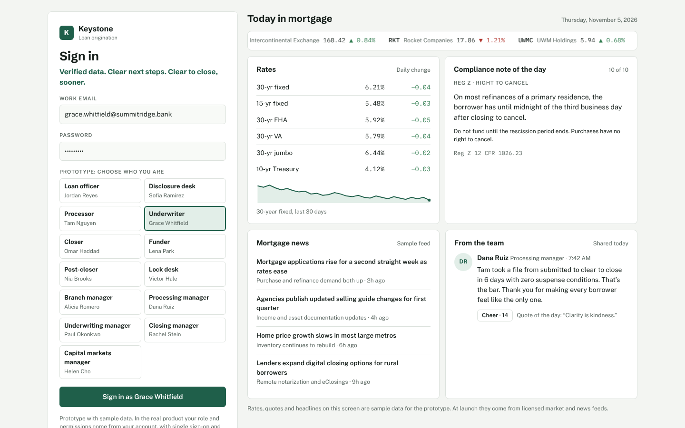
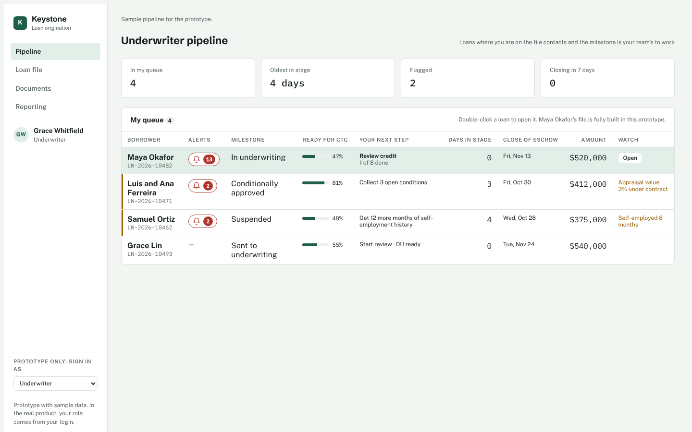
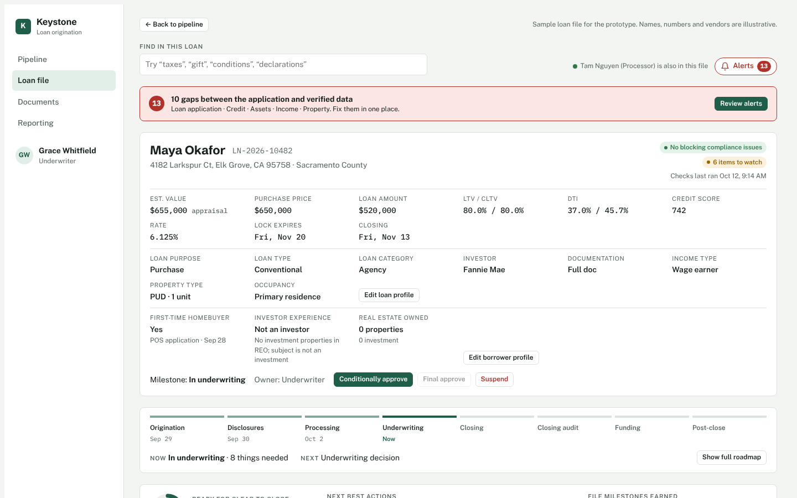

# Keystone

**An AI-powered loan origination system (LOS) for retail mortgage lending.**
Verified data. Clear next steps. Clear to close, sooner.

> Keystone is in development. This repository holds a clickable prototype and product pages. All borrowers, loans, numbers and vendors in the prototype are sample data.

## See it live

- **[Clickable prototype](https://jelksmba.github.io/Keystone/)**: pipeline, loan file, conditions, eFolder, reporting
- **[Product overview](https://jelksmba.github.io/Keystone/overview.html)**: what Keystone does, stage by stage
- **[One platform instead of twenty vendors](https://jelksmba.github.io/Keystone/tech-stack.html)**: market research on the lender tech stack and cost to originate

## What Keystone does

Most lenders run an LOS plus a dozen outside tools for verifications, income calculation, ordering, compliance and QC, and staff move data between them by hand. Keystone puts that work in one place.

- **Digital first:** borrowers connect payroll, bank and tax accounts; verified data flows into the loan.
- **Verified, not stated:** every field shows where its value came from. Gaps between the application and verified data are flagged and fixed in one click.
- **Automated end to end:** milestones trigger orders, conditions, disclosures and compliance checks.
- **Guided work for every role:** loan officer, disclosure desk, processor, underwriter, closer, funder, post-closer, lock desk and their managers each get a checklist and next best actions.
- **Compliance and QC on every loan:** checks run at every milestone, with a closing audit before funding and a post-close audit before investor delivery.

## Try the prototype

1. Open the prototype, pick a role on the sign-in screen and sign in.
2. Double-click a loan in the pipeline.
3. Use the side menu to move through the loan application, the four C's (credit, income, assets, property), conditions and documents.
4. Click **Alerts** to see gaps between the application and verified data, and fix them in one click.
5. Sign out to switch roles and see each role's workflow and reporting.

## Built with

Plain HTML, CSS and JavaScript in single files. No build step, no dependencies. Fonts from Google Fonts.

---

Built by Jammie Jelks. © 2026. All rights reserved.
